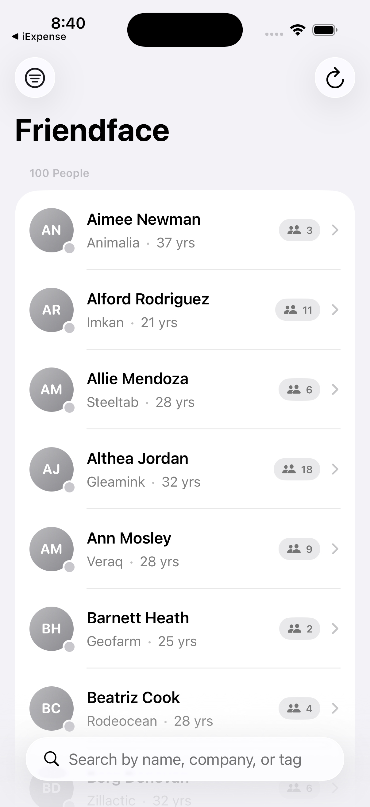
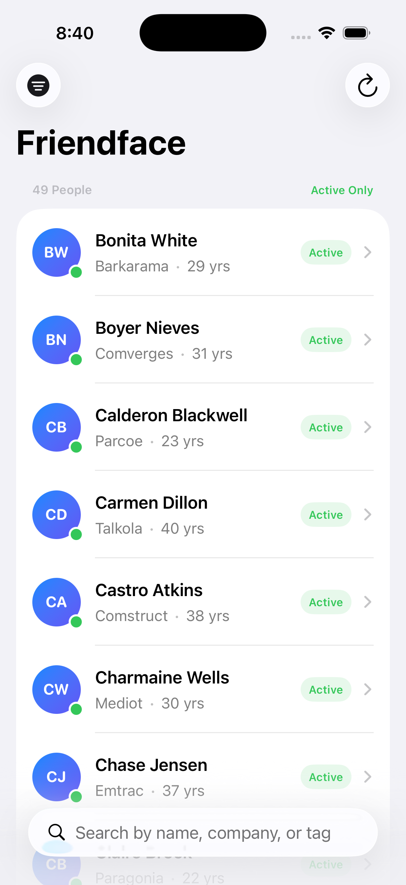
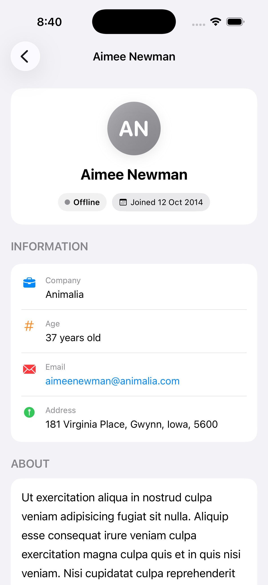
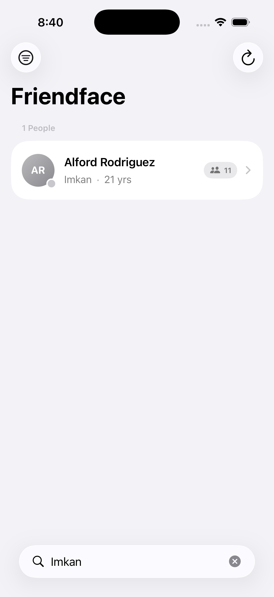

# Friendface 👥

[](https://developer.apple.com/ios/)
[](https://swift.org/)
[](https://developer.apple.com/xcode/swiftui/)
[](https://developer.apple.com/documentation/swiftdata)

An iOS social directory application built with modern **SwiftUI** and **SwiftData** that fetches remote user records, converts JSON into native Swift types, caches data locally for full offline support, and presents an interconnected network of user profiles and friends.

Developed as the milestone project for **Projects 10–12 (Days 60 & 61)** in Paul Hudson's **[100 Days of SwiftUI](https://www.hackingwithswift.com/guide/ios-swiftui/5/3/challenge)** curriculum.

---

## 📖 Project Overview

The **Friendface** challenge tests mastery of:
- **Asynchronous Networking**: Downloading JSON from a remote endpoint (`https://www.hackingwithswift.com/samples/friendface.json`) using `URLSession` with `async/await`.
- **Codable & ISO-8601 Dates**: Decoding nested JSON structures, arrays, and ISO-8601 timestamps (`2015-11-10T01:47:18-00:00`) using `.dateDecodingStrategy = .iso8601`.
- **SwiftData Local Persistence**: Modeling entities with `@Model`, setting up cascade delete relationships, and querying data reactively with `@Query`.
- **Offline First**: Checking if cached data exists (`users.isEmpty`) before initiating network requests, ensuring seamless offline functionality and zero redundant downloads.
- **Interconnected Social Graph**: Tapping on any friend in a user's detail view navigates directly to that friend's full profile.

---

## 📱 App Previews

<p align="center">
  
  &nbsp;&nbsp;&nbsp;&nbsp;
  
  &nbsp;&nbsp;&nbsp;&nbsp;
  
  &nbsp;&nbsp;&nbsp;&nbsp;
  
</p>

<p align="center">
  <em>All Users List &bull; Active Users Filter &bull; Detailed User Profile &bull; Real-time Search</em>
</p>

---

## ✨ Features

- **Reactive SwiftData Cache**: Persists 100 user profiles and their friend connections using SwiftData `@Model` classes with cascade deletion rules.
- **Offline Functionality**: App instantly loads previously downloaded records on cold start without waiting for network connectivity.
- **Active / Offline Indicators**: Visual green status halos for active users and neutral indicators for offline users.
- **Search & Filter**: Search by name, company, or interest tags, plus a quick toolbar toggle for active members only.
- **Interactive Profiles**: Full detail view featuring:
  - Header profile card with initials avatar and registration date badge.
  - Interactive contact card with clickable `mailto:` email action, company, age, and address.
  - Formatted biographical about section.
  - Scrollable topic tag chips (`#tag`).
  - Interactive friends list linking to full friend profiles.
- **Pull-to-Refresh**: Seamless manual refresh using SwiftUI's native `.refreshable` modifier.

---

## 🏗️ Architecture & Code Structure

The project follows a clean architectural pattern separating network transfer objects (DTOs), persistence models, services, and SwiftUI presentation:

```
Friendface/
├── FriendfaceApp.swift     # App entry point configuring the SwiftData ModelContainer
├── Models/
│   ├── User.swift          # SwiftData @Model representing a User entity
│   ├── Friend.swift        # SwiftData @Model representing a Friend entity
│   └── UserDTO.swift       # Decodable transfer objects for network parsing
├── Services/
│   └── DataService.swift   # URLSession networking service with ISO-8601 date decoding
├── Views/
│   ├── ContentView.swift   # Root navigation view with search, filter, and task loading
│   ├── UserRowView.swift   # Individual list row with avatar, status badge, and info
│   └── UserDetailView.swift# Comprehensive user profile view with interconnected friend navigation
└── screenshots/            # Retina simulator screenshots for documentation
```

### Component Breakdown

| Component | Responsibility |
| :--- | :--- |
| **`User` & `Friend`** | SwiftData `@Model` classes storing cached user profiles and relationships. |
| **`UserDTO` & `FriendDTO`** | Pure `Codable` structs ensuring safe, decoupled network serialization. |
| **`DataService`** | Handles HTTP requests, User-Agent headers, status code validation, and JSON decoding. |
| **`ContentView`** | Drives list filtering, search, empty/loading states, and network sync on appearance. |
| **`UserDetailView`** | Displays structured profile information and resolves friend IDs against cached users. |

---

## 🛠️ How to Build and Run

### Prerequisites
- **macOS Sonoma (14.0)** or later
- **Xcode 15.0+** (Swift 5.9+)
- **iOS 17.0+ Simulator** (or physical iOS device)

### Using Xcode
1. Clone this repository:
   ```bash
   git clone git@github.com:selva7378/Friendface.git
   cd Friendface
   ```
2. Open `Friendface.xcodeproj` in Xcode:
   ```bash
   open Friendface.xcodeproj
   ```
3. Select an iOS 17+ Simulator (e.g. **iPhone 17 Pro**).
4. Press **`Cmd + R`** to build and run.

### Using Command Line (`xcodebuild`)
```bash
DEVELOPER_DIR=/Applications/Xcode.app/Contents/Developer xcodebuild \
  -scheme Friendface \
  -destination "platform=iOS Simulator,name=iPhone 17 Pro" \
  build
```
